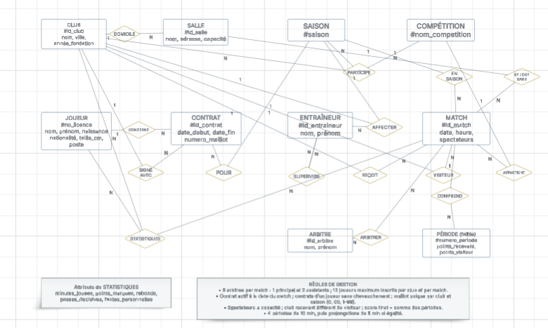

# Mini-projet Bases de données – Ligue Nationale de Basket (LNB)

**Module :** TI503N – Bases de données 1 : Concepts de base (EFREI Paris)
**Groupe :** Yanis, Amir, Nicolas

## Sommaire

1. [Analyse des besoins](#1-analyse-des-besoins-prompt-ricardo)
2. [Modèle Conceptuel de Données (MCD)](#2-modèle-conceptuel-de-données-mcd)
3. [MLD et MPD](#3-modèle-logique-mld-et-modèle-physique-mpd)
4. [Insertion des données](#4-insertion-des-données)
5. [Interrogation de la base](#5-interrogation-de-la-base)

**Fichiers du dépôt :** `1_creation.sql`, `2_contraintes.sql`, `3_insertion.sql`, `4_interrogation.sql`, `prompt_insertion.txt`, `MCD_Yanis_Amir_Nicolas.PNG`, `MLD_Yanis_Amir_Nicolas.png`. Les scripts SQL s'exécutent dans cet ordre sous MySQL 8.0.

---

## 1. Analyse des besoins (Prompt RICARDO)

Voici le prompt utilisé pour définir les règles métier et le dictionnaire de données :

| Partie à compléter | Valeur choisie |
|---|---|
| Domaine | Basket-ball professionnel |
| Type de structure | Organisation |
| Activité | Organiser et gérer les compétitions de basket professionnel masculin en France (calendrier, résultats, statistiques, suivi des clubs, joueurs, entraîneurs et arbitres) |
| Exemples | LNB, NBA, EuroLeague |
| Données collectées | Clubs et salles, joueurs et contrats, entraîneurs et assistants, saisons et compétitions, matchs et score par quart-temps, arbitres, statistiques des joueurs |
| Références | lnb.fr, ffbb.com, fiba.basketball |

> Tu travailles dans le domaine du basket-ball professionnel. Ton organisation a comme activité d'organiser et de gérer les compétitions de basket professionnel masculin en France (championnat Betclic ÉLITE, championnat ÉLITE 2 et Leaders Cup) : calendrier des matchs, enregistrement des résultats et des statistiques, suivi des clubs, des joueurs, des entraîneurs et des arbitres. C'est une organisation comme la Ligue Nationale de Basket (LNB) en France, la NBA aux États-Unis ou l'EuroLeague en Europe. Les données ont été collectées sur les clubs et les salles où ils jouent, les joueurs et leurs contrats avec les clubs, les entraîneurs et leurs assistants, les saisons et les compétitions, les matchs et leur score à chaque quart-temps, les arbitres de chaque match, ainsi que les statistiques des joueurs à chaque match. Inspire-toi des sites web suivants : https://www.lnb.fr (site officiel de la LNB : clubs, calendrier, résultats, statistiques), https://www.ffbb.com (Fédération Française de BasketBall : licences, arbitrage) et https://www.fiba.basketball (règles officielles du basket-ball).
>
> Ton organisation veut appliquer MERISE pour concevoir un système d'information. Tu es chargé de la partie analyse, c'est-à-dire de collecter les besoins auprès de l'entreprise. Elle a fait appel à un étudiant en ingénierie informatique pour réaliser ce projet, tu dois lui fournir les informations nécessaires pour qu'il applique ensuite lui-même les étapes suivantes de conception et développement de la base de données.
>
> D'abord, établis les règles de gestions des données de ton organisation, sous la forme d'une liste à puce. Elle doit correspondre aux informations que fournit quelqu'un qui connaît le fonctionnement de l'entreprise, mais pas comment se construit un système d'information.
>
> Ensuite, à partir de ces règles, fournis un dictionnaire de données brutes avec les colonnes suivantes, regroupées dans un tableau : signification de la donnée, type, taille en nombre de caractères ou de chiffres. Il doit y avoir entre 25 et 35 données. Il sert à fournir des informations supplémentaires sur chaque donnée (taille et type) mais sans a priori sur comment les données vont être modélisées ensuite.
>
> Fournis donc les règles de gestion et le dictionnaire de données.

---

## 2. Modèle Conceptuel de Données (MCD)

Voici le schéma conceptuel de la base de données :



---

## 3. Modèle Logique (MLD) et Modèle Physique (MPD)

### 3.1 MLD

Le MLD a été réalisé avec **Lucidchart** à partir du MCD.
Source éditable : [MLD sur Lucidchart](https://lucid.app/lucidchart/2e5b9b8e-7f4f-44c1-82d8-12728bd7d6b9/view)


#### Notation textuelle

Clé primaire soulignée, clé étrangère précédée de `#`.

- **SALLE** (<u>id_salle</u>, nom_salle, adresse, capacite)
- **CLUB** (<u>id_club</u>, nom_club, ville, annee_fondation, #id_salle)
- **SAISON** (<u>saison</u>)
- **COMPETITION** (<u>nom_competition</u>)
- **JOUEUR** (<u>no_licence</u>, nom, prenom, date_naissance, nationalite, taille_cm, poste)
- **CONTRAT** (<u>id_contrat</u>, date_debut, date_fin, numero_maillot, #no_licence, #id_club, #saison)
- **ENTRAINEUR** (<u>id_entraineur</u>, nom, prenom, #id_club)
- **SUPERVISE** (<u>#id_assistant</u>, #id_superviseur)
- **MATCH_BASKET** (<u>id_match</u>, date_match, heure_match, spectateurs, #saison, #nom_competition, #id_club_recevant, #id_club_visiteur)
- **PERIODE** (<u>#id_match, numero_periode</u>, points_recevant, points_visiteur)
- **ARBITRE** (<u>id_arbitre</u>, nom, prenom)
- **ARBITRER** (<u>#id_match, #id_arbitre</u>)
- **STATISTIQUES** (<u>#no_licence, #id_match</u>, minutes_jouees, points_marques, rebonds, passes_decisives, fautes_personnelles)
- **PARTICIPE** (<u>#id_club, #saison, #nom_competition</u>)

#### Règles de transformation appliquées

| Élément du MCD | Règle | Résultat dans le MLD |
|---|---|---|
| Chaque entité | Une entité devient une table, son identifiant devient la clé primaire | 10 tables d'entités |
| DOMICILE, CONCERNE, SIGNÉ AVEC, POUR, AFFECTER, EN SAISON, SE JOUE DANS, REÇOIT, VISITEUR | Association binaire (x,1)–(x,N) : la clé du côté N migre comme clé étrangère du côté 1 | `CLUB.id_salle`, `CONTRAT.no_licence / id_club / saison`, `ENTRAINEUR.id_club`, `MATCH_BASKET.saison / nom_competition / id_club_recevant / id_club_visiteur` |
| REÇOIT et VISITEUR | Deux associations entre les mêmes entités : deux clés étrangères distinctes vers CLUB, renommées selon leur rôle | `id_club_recevant`, `id_club_visiteur` |
| ARBITRER, STATISTIQUES | Association (x,N)–(x,N) : nouvelle table dont la clé primaire est composée des deux clés étrangères ; les attributs de l'association y sont placés | Tables `ARBITRER` et `STATISTIQUES` |
| PARTICIPE (ternaire) | Association n-aire : nouvelle table dont la clé primaire regroupe les 3 identifiants | Table `PARTICIPE` |
| PÉRIODE (entité faible) via COMPREND | La clé primaire combine la clé du match (identifiant fort) et l'identifiant relatif | `PERIODE (#id_match, numero_periode)` |
| SUPERVISE (réflexive) | Association réflexive (0,1)–(0,N) traduite par une table de liaison dont la clé primaire est l'assistant, ce qui garantit un seul superviseur par assistant | Table `SUPERVISE` |

**Pourquoi SUPERVISE est une table à part :** la traduction classique ajoute une clé étrangère `id_superviseur` dans ENTRAINEUR. MySQL refuse cependant de propager un `ON UPDATE CASCADE` vers la même table (erreur 1451). Or la consigne impose que les modifications de clés référencées se fassent sans erreur. La table SUPERVISE respecte la même cardinalité et règle ce problème.

**Pourquoi MATCH_BASKET :** `MATCH` est un mot réservé en MySQL.

### 3.2 MPD

Les scripts se lancent dans cet ordre (MySQL 8.0) :

1. [`1_creation.sql`](1_creation.sql) : création de la base `lnb_basket`, des 14 tables, des clés primaires, des clés étrangères et des `NOT NULL`.
2. [`2_contraintes.sql`](2_contraintes.sql) : contraintes de validation issues des règles métier.

#### Gestion des clés étrangères

Toutes les clés étrangères ont `ON UPDATE CASCADE` : si une clé primaire change, les lignes qui la référencent sont mises à jour automatiquement.

| Politique de suppression | Clés étrangères concernées | Justification |
|---|---|---|
| `ON DELETE CASCADE` | CONTRAT, MATCH_BASKET, PERIODE, ARBITRER, STATISTIQUES, PARTICIPE, SUPERVISE | La ligne n'a pas de sens sans son parent (un contrat sans joueur, une période sans match…) |
| `ON DELETE SET NULL` | `CLUB.id_salle`, `ENTRAINEUR.id_club` | Le lien est facultatif : un club peut temporairement ne pas avoir de salle, un entraîneur peut être sans club |

#### Contraintes de validation (`2_contraintes.sql`)

| Type | Exemples |
|---|---|
| `DEFAULT` | spectateurs, points par période et statistiques à 0 par défaut |
| `UNIQUE` | nom de club ; (nom, adresse) d'une salle ; **numéro de maillot unique par club et saison** ; un club ne reçoit pas deux matchs au même créneau |
| `CHECK` intervalle | capacité de salle, année de fondation, taille, date de naissance, heure du match, **numéro de période de 1 à 10** (4 quart-temps puis prolongations), minutes jouées, **5 fautes maximum** |
| `CHECK` liste (`IN`) | poste (Meneur, Arrière, Ailier, Ailier fort, Pivot) ; compétition (Betclic ÉLITE, ÉLITE 2, Leaders Cup) |
| `CHECK` format (regex) | saison `AAAA-AAAA` avec années consécutives ; licence `2 lettres + 6 chiffres` ; **maillot 0, 00 ou 1 à 99** ; pas de chiffres dans les noms |
| `CHECK` multi-colonnes | date de fin du contrat après la date de début |
| Triggers | **club recevant ≠ club visiteur** ; **spectateurs ≤ capacité de la salle** ; **3 arbitres maximum par match** ; **pas de chevauchement de contrats** pour un joueur ; un entraîneur ne se supervise pas lui-même |

Les règles en gras viennent directement des règles de gestion du MCD. Certaines sont écrites en triggers car MySQL interdit un `CHECK` sur une colonne de clé étrangère qui a une action `CASCADE` / `SET NULL`, et un `CHECK` ne peut pas consulter d'autres lignes ou d'autres tables.

**Règle non stockée :** le score final d'un match est la somme des points de ses périodes. Il n'est pas stocké, car ce serait une donnée calculée (redondance contraire à la 3FN) ; il sera obtenu par une requête `SUM` sur PERIODE.

#### Tests réalisés

Les deux scripts ont été exécutés sur MySQL 8.0 avec un jeu d'essai. Chaque contrainte rejette bien une insertion invalide (exemples : maillot `00` en double dans un même club et saison → erreur 1062 ; 4ᵉ arbitre → trigger ; saison `2025-2027` → `ck_saison_format`). Les cascades fonctionnent : changer l'identifiant d'un club met à jour ses contrats, ses matchs et ses entraîneurs ; supprimer une salle met `CLUB.id_salle` à `NULL` ; supprimer un match supprime ses périodes, arbitrages et statistiques.

---

## 4. Insertion des données

Les données de `3_insertion.sql` ont été générées par une IA générative avec le prompt ci-dessous (également dans `prompt_insertion.txt`). Il reprend la forme du prompt du TP1 : le modèle relationnel, les clés, l'ordre de remplissage des tables, puis les contraintes à respecter.

### 4.1 Prompt utilisé

> Donne les requêtes d'insertion permettant de remplir la base de données dont le modèle relationnel est le suivant :
>
> SALLE(id_salle, nom_salle, adresse, capacite) – Clé primaire : id_salle
> SAISON(saison) – Clé primaire : saison
> COMPETITION(nom_competition) – Clé primaire : nom_competition
> JOUEUR(no_licence, nom, prenom, date_naissance, nationalite, taille_cm, poste) – Clé primaire : no_licence
> ARBITRE(id_arbitre, nom, prenom) – Clé primaire : id_arbitre
> CLUB(id_club, nom_club, ville, annee_fondation, #id_salle) – Clé primaire : id_club
> CONTRAT(id_contrat, date_debut, date_fin, numero_maillot, #no_licence, #id_club, #saison) – Clé primaire : id_contrat
> ENTRAINEUR(id_entraineur, nom, prenom, #id_club) – Clé primaire : id_entraineur
> SUPERVISE(#id_assistant, #id_superviseur) – Clé primaire : id_assistant
> MATCH_BASKET(id_match, date_match, heure_match, spectateurs, #saison, #nom_competition, #id_club_recevant, #id_club_visiteur) – Clé primaire : id_match
> PERIODE(#id_match, numero_periode, points_recevant, points_visiteur) – Clé primaire : (id_match, numero_periode)
> ARBITRER(#id_match, #id_arbitre) – Clé primaire : (id_match, id_arbitre)
> STATISTIQUES(#no_licence, #id_match, minutes_jouees, points_marques, rebonds, passes_decisives, fautes_personnelles) – Clé primaire : (no_licence, id_match)
> PARTICIPE(#id_club, #saison, #nom_competition) – Clé primaire : (id_club, saison, nom_competition)
>
> Les clés primaires correspondent aux id, sauf si autre chose est précisé (quand c'est un attribut composé). Les clés étrangères sont identifiées par les #, et ont le même nom que les clés primaires auxquelles elles font référence (sauf pour id_club_recevant, id_club_visiteur, id_assistant et id_superviseur).
>
> Il doit y avoir :
> - Au moins 5 salles, 5 clubs, 8 joueurs, 4 arbitres et 5 entraîneurs.
> - Au moins 3 matchs avec leurs périodes découpées (quart-temps) et les statistiques détaillées des joueurs.
>
> Les clés étrangères doivent faire référence aux clés primaires existantes : donne les lignes en commençant par remplir les tables dans lesquelles il n'y a pas de clés étrangères, puis les tables dans lesquelles les clés étrangères font référence à des clés primaires des tables déjà remplies.
>
> Les données doivent respecter les contraintes de validation suivantes :
> - capacite dans SALLE entre 500 et 30000.
> - annee_fondation dans CLUB entre 1890 et 2026.
> - taille_cm dans JOUEUR entre 150 et 240.
> - date_naissance dans JOUEUR entre '1970-01-01' et '2012-12-31'.
> - poste dans JOUEUR IN ('Meneur', 'Arrière', 'Ailier', 'Ailier fort', 'Pivot').
> - nom_competition IN ('Betclic ÉLITE', 'ÉLITE 2', 'Leaders Cup').
> - no_licence respecte le format 2 lettres majuscules + 6 chiffres (ex. FR123456).
> - numero_maillot au format 0, 00 ou entre 1 et 99.
> - date_fin > date_debut dans CONTRAT.
> - spectateurs <= capacite de la salle recevante.
> - id_club_recevant != id_club_visiteur dans MATCH_BASKET.
> - id_assistant != id_superviseur dans SUPERVISE.
> - Maximum 3 arbitres par match dans ARBITRER.
>
> Assure-toi que les noms et prénoms des joueurs et intervenants font référence à des origines variées et sont mixtes. Fournis l'ensemble sous la forme d'un script SQL prêt à être exécuté.

### 4.2 Analyse du résultat

Le script généré s'exécute sans erreur après `1_creation.sql` et `2_contraintes.sql` : toutes les contraintes d'intégrité et de validation sont respectées. Nous avons dû corriger l'encodage des caractères accentués (« ÉLITE », « Arrière »…), qui faisait échouer les contraintes `CHECK`.

En comparant le résultat au prompt, nous avons relevé ces écarts :

- seuls 2 matchs sur 3 ont leurs périodes et leurs statistiques ; le match 103 (Leaders Cup) n'en a pas ;
- le match 101 se termine à 85-85 sans prolongation, ce qui est impossible au basket ;
- le match 102 n'a que 2 arbitres, alors que la règle de gestion en prévoit 3 ;
- la SIG Strasbourg joue un match de Leaders Cup sans être inscrite à cette compétition dans PARTICIPE, car aucune contrainte de la base ne vérifie cette cohérence.

Le volume reste faible (8 joueurs, 3 matchs). Une nouvelle génération sur une saison complète rendrait les statistiques plus parlantes.

---

## 5. Interrogation de la base

### 5.1 Scénario d'utilisation

**Rôle :** responsable Marketing et Performance sportive de la LNB.

**Objectif :** préparer la communication de la saison suivante. Il doit savoir quels matchs attirent le public, quels joueurs mettre en avant, comment sont composés les effectifs, et qui encadre et arbitre les rencontres.

Les 26 requêtes de `4_interrogation.sql` répondent à ces besoins :

| Données à extraire | Requêtes |
|---|---|
| Profil des joueurs : nationalités, âges, postes, tailles, joueurs étrangers | R1, R2, R3, R4, R7, R23 |
| Attractivité : affluence par compétition, remplissage des salles, matchs au-dessus de la moyenne, grandes salles | R5, R6, R8, R15, R24 |
| Résultats : score final de chaque match | R9, R14 |
| Têtes d'affiche : meilleurs marqueurs et passeurs, record sur un match | R10, R17, R20, R26 |
| Effectifs et contrats : contrats par club, agents libres, clubs actifs sur la nouvelle saison | R11, R13, R19, R25 |
| Encadrement et arbitrage : staff des clubs, hiérarchie des entraîneurs, arbitres les plus désignés | R12, R16, R18, R21 |
| Promotion des compétitions : clubs absents de la Leaders Cup | R22 |

Couverture des types de requêtes demandés :

| Type | Requêtes |
|---|---|
| Projections et sélections (tri, `DISTINCT`, `LIKE`, `IN`, `BETWEEN`) | R1 à R6 |
| Agrégations (`COUNT`, `SUM`, `AVG`, `MAX`, `GROUP BY`, `HAVING`) | R7 à R12 |
| Jointures (multiples, externes `LEFT JOIN`, auto-jointure) | R13 à R18 |
| Requêtes imbriquées (`NOT EXISTS`, `EXISTS`, `IN`, `NOT IN`, `ANY`, `ALL`, sous-requête scalaire) | R19 à R25 |

### 5.2 Étude des plans d'exécution

#### Requête étudiée (R26)

On cherche les noms et prénoms des meneurs ayant marqué plus de 15 points lors d'un match.

```sql
SELECT j.nom, j.prenom
FROM JOUEUR j
JOIN STATISTIQUES s ON j.no_licence = s.no_licence
WHERE j.poste = 'Meneur' AND s.points_marques > 15;
```

Elle utilise trois opérateurs de l'algèbre relationnelle : la sélection (σ), la jointure (⋈) et la projection (π). Traduction directe en algèbre :

π<sub>nom, prenom</sub> ( σ<sub>poste = 'Meneur' ∧ points_marques > 15</sub> ( JOUEUR ⋈<sub>no_licence</sub> STATISTIQUES ) )

**Données de départ :** JOUEUR contient 8 lignes et STATISTIQUES 6 lignes. Parmi elles, 2 joueurs sont meneurs et 3 lignes de statistiques dépassent 15 points.

**Méthode de calcul (exercice 6 du TD3) :** on applique les mêmes règles que dans le TD :

- une jointure entre A de taille n1 et B de taille n2 nécessite n1 × n2 instructions ;
- une projection ou une sélection scanne toute la table de taille n : elle fait n instructions.

Comme dans l'exercice 6, on part de l'arbre que le SGBD établit directement à partir de la requête. On l'optimise d'abord en descendant les sélections (question 1), puis en ajoutant des projections avant la jointure (question 2). Chaque nœud indique le nombre de lignes qu'il produit, comme dans Relax, et le nombre d'instructions qu'il exécute.

En algèbre relationnelle, une projection élimine les doublons (Relax fait de même). Mike James a dépassé 15 points dans deux matchs : il n'apparaît donc qu'une fois après une projection.

#### Arbre 1 : arbre initial établi par le SGBD


Ici :

- pour la jointure : 8 × 6 = 48 instructions ;
- pour la sélection : 6 instructions ;
- pour la projection : 2 instructions.

Au total, 48 + 6 + 2 = **56 instructions**.

#### Arbre 2 : sélections descendues avant la jointure

La condition `poste = 'Meneur'` ne porte que sur JOUEUR, et `points_marques > 15` que sur STATISTIQUES. On sépare donc la sélection en deux et on applique chaque partie directement sur sa table, avant la jointure.


Ici :

- pour la sélection sur JOUEUR : 8 instructions ;
- pour la sélection sur STATISTIQUES : 6 instructions ;
- pour la jointure : 2 × 3 = 6 instructions ;
- pour la projection : 2 instructions.

Au total, 8 + 6 + 6 + 2 = **22 instructions**.

#### Arbre 3 : sélections et projections avant la jointure

Comme à la question 2 de l'exercice 6, on ajoute des projections avant la jointure pour ne garder que les colonnes utiles. Côté JOUEUR, on garde `no_licence` (pour la jointure), `nom` et `prenom` (pour le résultat). Côté STATISTIQUES, on garde seulement `no_licence` : le doublon de Mike James disparaît, et il reste 2 lignes au lieu de 3.


Ici :

- pour la sélection puis la projection sur JOUEUR : 8 + 2 = 10 instructions ;
- pour la sélection puis la projection sur STATISTIQUES : 6 + 3 = 9 instructions ;
- pour la jointure : 2 × 2 = 4 instructions ;
- pour la projection finale : 1 instruction.

Au total, 10 + 9 + 4 + 1 = **24 instructions**.

#### Comparaison

| Opérateur | Arbre 1 | Arbre 2 | Arbre 3 |
|---|---|---|---|
| Sélections | 6 | 8 + 6 = 14 | 8 + 6 = 14 |
| Projections avant la jointure | – | – | 2 + 3 = 5 |
| Jointure | 8 × 6 = 48 | 2 × 3 = 6 | 2 × 2 = 4 |
| Projection finale | 2 | 2 | 1 |
| **Total** | **56** | **22** | **24** |

#### Conclusion

Descendre les sélections sous la jointure est l'optimisation décisive : on passe de 56 à 22 instructions, soit environ 2,5 fois moins. La jointure est l'opérateur le plus coûteux, car son coût est le produit des tailles de ses entrées. En filtrant d'abord, elle compare 2 × 3 couples au lieu de 8 × 6.

Les projections avant la jointure (arbre 3) éliminent les doublons et les colonnes inutiles : la jointure ne compare plus que 2 × 2 couples. Sur notre petit jeu de données, elles coûtent pourtant 5 instructions de parcours pour n'en économiser que 3. L'arbre 3 fait donc 24 instructions, contre 22 pour l'arbre 2.

Avec plus de données, l'arbre 3 devient le meilleur. Prenons une hypothèse pour une saison complète : 400 joueurs dont 40 meneurs ; 10 000 lignes de statistiques, dont 2 000 au-dessus de 15 points, réalisées par 300 joueurs différents ; parmi elles, 200 lignes de meneurs, qui concernent 30 meneurs différents. Avec les mêmes règles :

| | Arbre 1 | Arbre 2 | Arbre 3 |
|---|---|---|---|
| Calcul | 400 × 10 000 + 10 000 + 200 | 400 + 10 000 + 40 × 2 000 + 200 | 400 + 40 + 10 000 + 2 000 + 40 × 300 + 30 |
| **Total** | **4 010 200** | **90 600** | **24 470** |

L'arbre optimisé est donc l'**arbre 3** : on applique les sélections, puis les projections, le plus bas possible dans l'arbre, avant la jointure. C'est la démarche des questions 1 et 2 de l'exercice 6. Il coûte environ 164 fois moins que l'arbre initial à cette échelle. Sur notre petit jeu de données, l'arbre 2 reste légèrement meilleur (22 contre 24 instructions).

MySQL applique le même principe : `EXPLAIN FORMAT=TREE` sur cette requête montre que l'optimiseur filtre d'abord STATISTIQUES (`points_marques > 15`) avant de faire la jointure.

En SQL, contrairement à l'algèbre relationnelle, `SELECT` ne supprime pas les doublons : la requête R26 renvoie deux fois Mike James. Il faut écrire `SELECT DISTINCT` pour obtenir une seule ligne.
