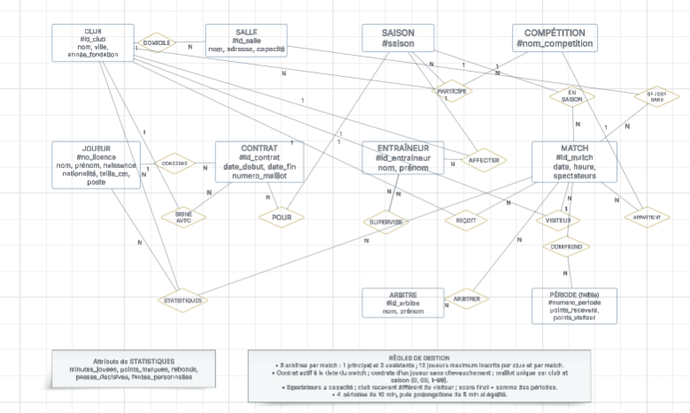

# Projet BDD - Partie 1

# Mini-Projet Bases de Données - Partie 1

## 1. Analyse des besoins (Prompt RICARDO)
Voici le prompt utilisé pour définir les règles métier et le dictionnaire de données :

Partie à compléter	Valeur choisie
Domaine	Basket-ball professionnel
Type de structure	Organisation
Activité	Organiser et gérer les compétitions de basket professionnel masculin en France (calendrier, résultats, statistiques, suivi des clubs, joueurs, entraîneurs et arbitres)
Exemples	LNB, NBA, EuroLeague
Données collectées	Clubs et salles, joueurs et contrats, entraîneurs et assistants, saisons et compétitions, matchs et score par quart-temps, arbitres, statistiques des joueurs
Références	lnb.fr, ffbb.com, fiba.basketball

Tu travailles dans le domaine du basket-ball professionnel. Ton organisation a comme activité d'organiser et de gérer les compétitions de basket professionnel masculin en France (championnat Betclic ÉLITE, championnat ÉLITE 2 et Leaders Cup) : calendrier des matchs, enregistrement des résultats et des statistiques, suivi des clubs, des joueurs, des entraîneurs et des arbitres. C'est une organisation comme la Ligue Nationale de Basket (LNB) en France, la NBA aux États-Unis ou l'EuroLeague en Europe. Les données ont été collectées sur les clubs et les salles où ils jouent, les joueurs et leurs contrats avec les clubs, les entraîneurs et leurs assistants, les saisons et les compétitions, les matchs et leur score à chaque quart-temps, les arbitres de chaque match, ainsi que les statistiques des joueurs à chaque match. Inspire-toi des sites web suivants : https://www.lnb.fr (site officiel de la LNB : clubs, calendrier, résultats, statistiques), https://www.ffbb.com (Fédération Française de BasketBall : licences, arbitrage) et https://www.fiba.basketball (règles officielles du basket-ball).

Ton organisation veut appliquer MERISE pour concevoir un système d'information. Tu es chargé de la partie analyse, c'est-à-dire de collecter les besoins auprès de l'entreprise. Elle a fait appel à un étudiant en ingénierie informatique pour réaliser ce projet, tu dois lui fournir les informations nécessaires pour qu'il applique ensuite lui-même les étapes suivantes de conception et développement de la base de données.

D'abord, établis les règles de gestions des données de ton organisation, sous la forme d'une liste à puce. Elle doit correspondre aux informations que fournit quelqu'un qui connaît le fonctionnement de l'entreprise, mais pas comment se construit un système d'information.

Ensuite, à partir de ces règles, fournis un dictionnaire de données brutes avec les colonnes suivantes, regroupées dans un tableau : signification de la donnée, type, taille en nombre de caractères ou de chiffres. Il doit y avoir entre 25 et 35 données. Il sert à fournir des informations supplémentaires sur chaque donnée (taille et type) mais sans a priori sur comment les données vont être modélisées ensuite.

Fournis donc les règles de gestion et le dictionnaire de données.

## 2. Modèle Conceptuel de Données (MCD)
Voici le schéma conceptuel de la base de données :

## 4. Étape 4 : Insertion des données

### Prompt utilisé pour l'IA générative :
> ## 4. Étape 4 : Insertion des données

### Prompt utilisé pour l'IA générative :
## 4. Étape 4 : Insertion des données

### Prompt au format TP1 utilisé pour l'IA générative :

> Donne les requêtes d’insertion permettant de remplir la base de données dont le modèle relationnel est le suivant : 
>
> SALLE(id_salle, nom_salle, adresse, capacite)
> Clé primaire : id_salle
>
> SAISON(saison)
> Clé primaire : saison
>
> COMPETITION(nom_competition)
> Clé primaire : nom_competition
>
> JOUEUR(no_licence, nom, prenom, date_naissance, nationalite, taille_cm, poste)
> Clé primaire : no_licence
>
> ARBITRE(id_arbitre, nom, prenom)
> Clé primaire : id_arbitre
>
> CLUB(id_club, nom_club, ville, annee_fondation, #id_salle)
> Clé primaire : id_club
>
> CONTRAT(id_contrat, date_debut, date_fin, numero_maillot, #no_licence, #id_club, #saison)
> Clé primaire : id_contrat
>
> ENTRAINEUR(id_entraineur, nom, prenom, #id_club)
> Clé primaire : id_entraineur
>
> SUPERVISE(#id_assistant, #id_superviseur)
> Clé primaire : id_assistant
>
> MATCH_BASKET(id_match, date_match, heure_match, spectateurs, #saison, #nom_competition, #id_club_recevant, #id_club_visiteur)
> Clé primaire : id_match
>
> PERIODE(#id_match, numero_periode, points_recevant, points_visiteur)
> Clé primaire : (id_match, numero_periode)
>
> ARBITRER(#id_match, #id_arbitre)
> Clé primaire : (id_match, id_arbitre)
>
> STATISTIQUES(#no_licence, #id_match, minutes_jouees, points_marques, rebonds, passes_decisives, fautes_personnelles)
> Clé primaire : (no_licence, id_match)
>
> PARTICIPE(#id_club, #saison, #nom_competition)
> Clé primaire : (id_club, saison, nom_competition)
>
> Les clés primaires correspondent aux id, sauf si autre chose est précisé (quand c'est un attribut composé). Les clés étrangères sont identifiées par les #, et ont le même nom que les clés primaires auxquelles elles font référence (sauf pour id_club_recevant, id_club_visiteur, id_assistant et id_superviseur).
>
> Il doit y avoir :
> - Au moins 5 salles, 5 clubs, 8 joueurs, 4 arbitres et 5 entraîneurs.
> - Au moins 3 matchs avec leurs périodes découpées (quart-temps) et les statistiques détaillées des joueurs.
>
> Les clés étrangères doivent faire référence aux clés primaires existantes : donne les lignes en commençant par remplir les tables dans lesquelles il n'y a pas de clés étrangères, puis les tables dans lesquelles les clés étrangères font référence à des clés primaires des tables déjà remplies.
>
> Les données doivent respecter les contraintes de validation suivantes :
> - capacite dans SALLE entre 500 et 30000.
> - annee_fondation dans CLUB entre 1890 et 2026.
> - taille_cm dans JOUEUR entre 150 et 240.
> - date_naissance dans JOUEUR entre '1970-01-01' et '2012-12-31'.
> - poste dans JOUEUR IN ('Meneur', 'Arrière', 'Ailier', 'Ailier fort', 'Pivot').
> - nom_competition IN ('Betclic ÉLITE', 'ÉLITE 2', 'Leaders Cup').
> - no_licence respecte le format 2 lettres majuscules + 6 chiffres (ex. FR123456).
> - numero_maillot au format 0, 00 ou entre 1 et 99.
> - date_fin > date_debut dans CONTRAT.
> - spectateurs <= capacite de la salle recevante.
> - id_club_recevant != id_club_visiteur dans MATCH_BASKET.
> - id_assistant != id_superviseur dans SUPERVISE.
> - Maximum 3 arbitres par match dans ARBITRER.
>
> Assure-toi que les noms et prénoms des joueurs et intervenants font référence à des origines variées et sont mixtes. Fournis l'ensemble sous la forme d’un script SQL prêt à être exécuté.